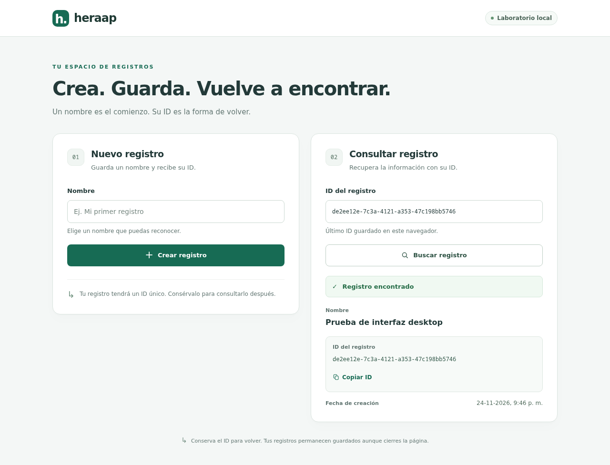

# Frontend de Heraap

React + Vite + TypeScript para crear un registro por nombre y recuperarlo con su
ID. Entrada: `src/main.tsx`; interfaz: `src/App.tsx`. Se conecta a la API REST de
LocalEmu y no contiene credenciales AWS.

## Preparación y desarrollo

Versiones: Node.js 22.23.5, npm 10.9.9, React/React DOM 19.3.1, Vite 8.3.8,
TypeScript 5.9.3 y Playwright 1.65.1. Desde la raíz del repositorio:

```bash
nvm install
nvm use
npm ci
npm run setup
cp frontend/.env.example frontend/.env.local
```

Definir en `frontend/.env.local` la URL real:

```dotenv
VITE_API_BASE_URL=http://IP_SERVIDOR:4566/_aws/execute-api/API_ID/local
```

`npm run deploy:backend` imprime `ApiUrl` y guarda los outputs en
`.state/backend-outputs.json`. Para abrir la app desde otro equipo, reemplazar
`127.0.0.1` por la IP LAN del servidor. El alias `localemu` pertenece a Docker,
no al navegador.

`npm run dev` sirve en `http://127.0.0.1:5173`. En un equipo remoto se puede usar
`ssh -L 5173:127.0.0.1:5173 usuario@servidor` y abrir esa URL local.
Reiniciar Vite después de cambiar el entorno. El build también lee
`frontend/.env.production.local`, que tiene prioridad sobre `.env.local`.
Ambos archivos se excluyen de Git. La URL se incorpora al JavaScript al compilar.

## Uso

1. Escribir un nombre y pulsar **Crear registro**.
2. Revisar nombre, ID y fecha. **Copiar ID** permite conservarlo.
3. El ID creado se completa en **Consultar registro**.
4. Recargar y pulsar **Buscar registro**: se recupera el último ID válido guardado
   por ese navegador para ese origen.
5. También se puede pegar otro ID. Un ID inexistente muestra un mensaje y no
   reemplaza el último ID válido guardado.

La app valida campos vacíos, muestra carga y errores recuperables y bloquea envíos
repetidos durante la creación. Cambiar el ID cancela la consulta anterior para no
mostrar datos obsoletos. Solo se recuerda el ID; los registros permanecen en DynamoDB.
Si el navegador restringe el almacenamiento, la creación sigue funcionando y se
pide conservar el ID manualmente. La copia tiene una alternativa para HTTP en la
LAN; si el navegador también la bloquea, el ID sigue seleccionable.

## Build y publicación manual de revisión

Con backend y bucket ya desplegados, desde la raíz:

```bash
npm run build
docker cp frontend/dist/. heraap-localemu:/tmp/heraap-frontend-dist
bash scripts/localemu.sh aws s3 sync /tmp/heraap-frontend-dist/ \
  s3://heraap-frontend-local/ --delete
docker exec heraap-localemu rm -rf /tmp/heraap-frontend-dist
```

Abrir `http://IP_SERVIDOR:4566/heraap-frontend-local/index.html`. `base: './'` y
el enlace de inicio relativo permiten servir HTML/JS/CSS desde S3. Esta publicación
es manual; el comando completo `npm run deploy:local` y el runner son tareas
posteriores. `--delete` se limita al bucket frontend, sin cambiar DynamoDB.

## Pruebas

```bash
# Cliente y almacenamiento, sin backend.
npm run test:frontend

# Instalar Chromium una vez.
cd frontend
npx --no-install playwright install chromium --only-shell
cd ..

# Escritorio/móvil con respuestas controladas, sin LocalEmu.
npm run test:frontend:e2e

# API real: requiere backend desplegado y sus outputs.
npm run test:frontend:e2e:local

# Build S3 publicado, sin iniciar Vite.
HERAAP_E2E_FRONTEND_URL=http://IP_SERVIDOR:4566/heraap-frontend-local/index.html \
  npm run test:frontend:e2e:local
```

Si Playwright pide dependencias Linux, instalarlas según su diagnóstico. CI usa
`playwright install --with-deps` en su runner efímero. Puede definirse
`PLAYWRIGHT_BROWSERS_PATH` tanto al instalar como al probar para elegir otra
ubicación del navegador.

El modo controlado cubre creación, copia, recarga, consulta, 404, red/500,
validación, carga, duplicados, almacenamiento restringido y cancelación. CI lo
ejecuta en runners de GitHub sin acceder al servidor local.

El modo real crea registros `Prueba de interfaz desktop/mobile`, consulta después
de recargar y comprueba copia e inicio. Conserva los registros: aún no hay endpoint
de eliminación. Los modos se excluyen explícitamente en Playwright.

## Verificación visual

Capturas seleccionadas del build S3 conectado al backend real:



[Captura móvil](docs/frontend-mobile.png).

## Archivos

- `src/App.tsx`: formularios, estados y coordinación de solicitudes.
- `src/api.ts`: cliente HTTP tipado, timeout, validación y errores.
- `src/storage.ts`: último ID con acceso defensivo a localStorage.
- `src/RecordDetails.tsx`: resultado y copia.
- `src/App.css`: diseño responsive, foco, carga y errores.
- `tests/`: pruebas de cliente/almacenamiento con `node:test`.
- `e2e/`: pruebas de navegador Playwright.
- `docs/`: capturas revisadas; los resultados y trazas de ejecución no van a Git.
